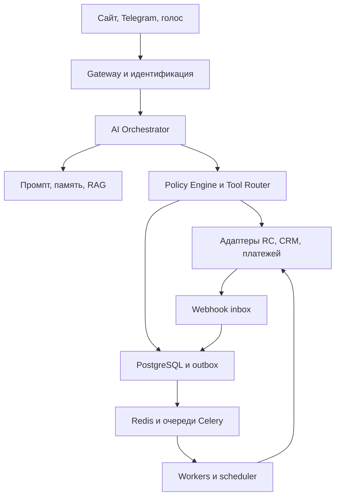

# IA Welcome to Moscow — технический комплект v4.0

Дата: 04.10.2026. Исходный масштаб: около 100 квартир и база гостей; целевой масштаб — 10 000 объектов и до 1 млн профилей. Эти числа не определяют одновременную нагрузку. Размеры серверов назначаются после измерения пиковых запросов, диалогов, событий и голосовых соединений.

Комплект включает системный промпт, 82 внутренних AI-tools с отдельными JSON Schema input/output, OpenAPI 3.1, справочный SQL DDL из 39 таблиц, схему событий, входящий webhook RealtyCalendar, архитектуру, серверный каркас проверки контрактов и план запуска. Это спецификация и проверяемый каркас, а не законченная платформа или подключённые интеграции.

## 1. Самое важное ограничение интеграции

Проверенная официальная документация RealtyCalendar описывает исходящие webhook и одновременно сообщает об отсутствии официально поддерживаемого внешнего партнёрского API. Поэтому create_booking, get_live_price и check_availability в этом комплекте — функции ВАШЕГО backend, не обещание существования одноимённых endpoint RealtyCalendar.

Два режима:

| Режим | Что работает | Как говорить гостю |
|---|---|---|
| ASSISTED, стартовый | Каталог из согласованного импорта, события RC, консультации, заявки менеджеру, ссылка на существующий модуль бронирования | «Передала заявку; менеджер подтвердит наличие и цену» |
| TRANSACTIONAL, после подтверждения доступа | Live availability/quotes и запись в брони через документированный согласованный adapter | «Бронирование подтверждено» только после подтверждения источника |

В ASSISTED каталог может показывать характеристики и ссылку на модуль, но неполная локальная база бронирований не подтверждает свободные даты. Разрешение создавать заявки не разрешает менять календарь RC. Не строить коммерческий workflow на выдуманных endpoint, внутреннем браузерном API или автоматизации чужого личного кабинета без согласованного способа доступа.

Перед включением TRANSACTIONAL получить: разрешённый способ чтения/записи; authentication; rate limits; правила hold/commit и отмены; идентификаторы объектов/комнат; валюту и единицы денег; гарантии порядка и повторов webhook; initial export; механизм проверки операции после timeout; тестовую среду или согласованные тестовые брони. Ответы фиксировать в integration_configs и ADR.

## 2. Архитектура

Выбор для MVP: модульный монолит FastAPI плюс отдельные процессы workers/scheduler. Доменная логика общая; HTTP worker не запускает scheduler. На старте не нужно 82 отдельных сервиса или 82 отдельные LLM. Это функции системы, а роли агентов — ограничения доступных инструментов.

| Компонент | Выбор и назначение |
|---|---|
| Язык/API | Python 3.12; FastAPI; Uvicorn; Pydantic 2 |
| ORM/миграции | SQLAlchemy 2 async + asyncpg; Alembic; явные транзакции |
| Основная БД | PostgreSQL 16, поддерживаемый исправленный minor release |
| RAG | pgvector; сначала ограниченный поиск по tenant/audience/status, затем векторное ранжирование |
| Кэш | Redis: короткий контекст, rate limits, короткие кэшированные результаты; не источник денег/брони |
| Очередь | Celery 5.x с Redis broker; версия фиксируется lock-файлом после проверки совместимости с Python 3.12 |
| Scheduler | Долгосрочные задания в PostgreSQL; короткий периодический dispatcher ставит ближайшие задачи в очередь |
| LLM/голос | Адаптеры LLM, STT/TTS или realtime; провайдер выбирается отдельно по языку, задержке, доступности и обработке данных |
| Файлы | Закрытое объектное хранилище; короткоживущие подписанные ссылки; публичные фото отдельно |
| Наблюдаемость | OpenTelemetry, метрики, структурированные редактированные логи, error tracking |
| Развёртывание | Контейнеры; отдельные web/worker/scheduler; CI, миграции, staging, резервные копии и восстановление |

HTTP интеграции использовать через async HTTP client с ограничениями соединений и timeout. Для Celery задач выбрать единый синхронный task wrapper вокруг доменного сервиса, с корректным управлением event loop и отдельными ресурсами процессов; не делить async SQLAlchemy engine между процессами. Не держать DB transaction открытой во время длительного LLM/внешнего HTTP вызова.

## 3. Роли и маршрутизация

| Роль | Функции | Ограничения |
|---|---|---|
| Supervisor | Классификация, выбор роли, escalation | Не получает финансовые credentials; не исполняет возвраты |
| Sales | Progressive profiling, search, compare, quote | Нет доступа к корпоративным отчётам или чужим профилям |
| Booking | Quote, confirmation, create/modify/cancel | Только capabilities, identity, approval и server policy |
| Concierge | Места, погода, маршруты | Не изменяет брони |
| Support | Service request, incident, human handoff | Не обещает компенсацию, не исполняет возврат |
| Retention | Предпочтения, trip intent, followup, loyalty | Только текущие consent/channel и frequency cap |
| Corporate | Policy, approval, invoice/report | Company membership и роль представителя |

Supervisor получает intent и reason_codes, а не chain-of-thought. Передача между ролями меняет подмножество registry, сохраняя один подтверждённый guest_id и диалог. По умолчанию модель видит около 5–15 релевантных tools. Состав выбирается динамически, число является проектным ориентиром.

## 4. Контракт инструментов

Каждый файл contracts/tools/<name>.json содержит описание, группу, scope, режим READ/WRITE, confirmation_required, mvp, server_policy, input_schema и output_schema. Полный каталог в contracts/tool_catalog.json. JSON Schema Draft 2020-12; shared definitions включены в каждый файл, поэтому внешняя загрузка схем не нужна.

Input — только аргументы предметной области. Trusted context формируется сервером: tenant_id, actor_id, verified_guest_id, scopes, request_id, conversation_id, confirmation_id и idempotency_key. Модель не выбирает tenant_id и не присваивает себе scope. Если инструмент принимает guest_id, сервер проверяет равенство проверенному гостю или отдельно разрешённую staff/company роль.

Success: ok=true, request_id, data, source, observed_at. Failure: ok=false, request_id, error {code,message,retryable,operation_id}. Ошибки HTTP auth/transport отделены от доменных ошибок envelope. Pending/UNKNOWN отражаются в data.status, не описываются как выполненное действие.

Правила валидатора: format checking для uuid/date/date-time/uri включён; additionalProperties=false для модельного ввода; максимумы массивов/строк; cross-field validation в domain service. Схема сама не проверяет check_out>check_in, баланс платежей, вместимость, полномочия или подлинность evidence — это обязательные серверные проверки.

Денежные величины: integer amount_minor + currency. RUB — копейки. Не float. Конвертация внешней суммы RC допускается только после подтверждения единиц; amount=3000 не интерпретируется автоматически как 3000 копеек. Количество ночей — календарная разница дат, не duration UTC часов.

Ошибка UNKNOWN_RESULT обязательна, если внешний запрос мог исполниться, а ответ потерян. Scope и confirmation проверки проводятся до исполнения. Инструмент get_business_metrics выдаётся только staff analyst; правило «не показывай гостю» в промпте недостаточно.

## 5. Идемпотентность, подтверждение и гонки

Idempotency key генерирует backend на логическую операцию, хранит до истечения срока возможного повтора. Уникальность: tenant+actor+tool+key. Тот же key и тот же hash возвращают прежний результат/operation. Тот же key и иной payload возвращают CONFLICT. Новый ключ не является способом обойти неизвестный исход.

Confirmation хранит action, actor, conversation, payload_hash, quote/terms snapshot, expires_at, evidence_message_id. Подтверждение создаётся/фиксируется по конкретному показанному предложению; LLM не может установить статус CONFIRMED произвольным параметром. Потребление происходит один раз в той же локальной транзакции, что создание operation; повтор читает существующую operation, не требует второго подтверждения.

Порядок create_booking:

1. Проверить identity/object scope/capability и привязку котировки.
2. Проверить срок quote, актуальность условий, состав гостей, обязательные суммы.
3. Проверить подтверждение на этот snapshot и корпоративный approval при необходимости.
4. Создать operation PENDING и локальную provisional запись, commit.
5. Проверить наличие/hold у authoritative provider, выполнить создание с доступной защитой от повтора.
6. По подтверждённому ответу присвоить provider id, status/version и записать outbox в одной транзакции.
7. При timeout поставить UNKNOWN, запустить reconciliation, не отправлять подтверждение брони.
8. Отправить гостю реальный статус; оплата идёт по выбранному согласованному workflow.

Локальный exclusion constraint защищает собственную allocation ledger от пересечения ночей. Он не блокирует продажи на Авито/RC/у партнёра. Нужна атомарная операция у authoritative источника или управляемый менеджером режим. Конфликт внешних импортированных бронирований сохранять и эскалировать; не терять реальный факт из-за локального constraint.

## 6. Три независимых статуса

Не смешивать статус брони, оплату, проживание и этап продаж.

| Измерение | Состояния | Основные разрешённые переходы |
|---|---|---|
| Booking | REQUESTED, PENDING_PROVIDER, CONFIRMED, CANCEL_PENDING, CANCELLED, EXPIRED, REJECTED, DELETED | REQUESTED→PENDING_PROVIDER/CONFIRMED/REJECTED/EXPIRED/CANCELLED; PENDING_PROVIDER→CONFIRMED/REJECTED/CANCEL_PENDING; CONFIRMED→CANCEL_PENDING; CANCEL_PENDING→CANCELLED/CONFIRMED |
| Payment | UNPAID, PENDING, PARTIALLY_PAID, PAID, REFUND_PENDING, PARTIALLY_REFUNDED, REFUNDED, DISPUTED | UNPAID→PENDING/PARTIALLY_PAID/PAID; PENDING→UNPAID/PARTIALLY_PAID/PAID; PAID→REFUND_PENDING/DISPUTED; REFUND_PENDING→PAID/PARTIALLY_REFUNDED/REFUNDED |
| Stay | NOT_ARRIVED, CHECKED_IN, CHECKED_OUT, NO_SHOW | NOT_ARRIVED→CHECKED_IN/NO_SHOW; CHECKED_IN→CHECKED_OUT |

Точная payment state вычисляется из проверенного ledger платежей/возвратов; таблица выше иллюстрирует обычные пути, не заменяет финансовый ledger. Частичный платёж может требовать возврата. Залог учитывается отдельно от оплаты проживания. Удаление платежной записи RC не трактуется автоматически как возврат у банка.

CANCELLED→CONFIRMED допустим только как документированное восстановление у источника с новой проверкой наличия, прав и аудитом. DELETED — факт удаления провайдером, не команда стереть историю. Переход в DELETED допустим при подтверждённом внешнем событии из любого подходящего состояния; запись остаётся для аудита. Изменение CONFIRMED→CONFIRMED повышает version, меняя только подтверждённые параметры. NO_SHOW не устанавливается автоматически только по часам без операционной политики.

Funnel NEW_LEAD→DISCOVERY→QUALIFIED→SEARCHING→OPTIONS_PRESENTED→OPTION_SELECTED→BOOKING_STARTED→... является аналитикой диалога. BOOKED в funnel разрешён только при CONFIRMED booking. IN_STAY требует подтверждённого stay status, а не наступления даты.

## 7. RealtyCalendar webhook — подтверждённый формат

Официально описанные action: create_booking, update_booking, cancel_booking, delete_booking. Верхний status: booked, deleted, canceled, request. Тело data.booking содержит id, agency_id, begin_date/end_date, realty_id, client и другие поля; data.changes присутствует в описании изменения. contracts/realtycalendar_webhook.schema.json — минимальный tolerant boundary schema, не копия всех необязательных полей RC.

| Вход RC | Наше событие/состояние | Проверка |
|---|---|---|
| create_booking + booked | booking.confirmed / CONFIRMED | Проверить подлинность, agency и mapping |
| create_booking + request | booking.requested / REQUESTED | Не отправлять подтверждение брони |
| update_booking + booked | booking.changed или booking.confirmed | Сравнить предыдущий status/version и разрешённость восстановления |
| update_booking + request | Обновление заявки | Не переводить активную бронь в заявку без согласованного правила |
| cancel_booking или status=canceled | booking.cancelled / CANCELLED | Проверить согласованность action/status |
| delete_booking или status=deleted | booking.deleted / DELETED | Tombstone, история сохраняется |
| Изменение массива платежей | Внутреннее reconciliation платежей | Не считать каждое update_booking новой оплатой |

Если action и status противоречат друг другу, событие в quarantine, затем сверка; не угадывать. Не использовать undocumented status_cd numeric mapping. Метки времени и hashes позволяют выявлять повторы, но не дают абсолютной гарантии порядка.

Webhook RC ожидает HTTP 200; отправки повторяются при недоступности. Старые брони автоматически не выгружаются при подключении. По официальному описанию изменения уже прошедших бронирований через webhook не поступают. Следовательно, initial backfill и периодическая сверка необходимы через согласованный экспорт/доступ; webhook — не полный журнал всех финансовых изменений.

Собственные события payment.succeeded, stay.checked_in, followup.sent и другие НЕ заявляются как native webhook RC. CRM provider ещё не выбран: события guest.created, consent.revoked и corporate.approved — наши доменные события; внешний CRM adapter должен отдельно сопоставить фактический payload.

## 8. Приём, проверка и доставка событий

Endpoint нашей системы: POST /webhooks/realtycalendar/<opaque_connector_id>. Это наш URL для настройки RC, не URL API RC.

1. TLS, ограничение размера, rate limit, JSON boundary validation.
2. Определить tenant по серверному connector mapping, не по произвольному agency_id.
3. Подтвердить authenticity способом, реально доступным провайдеру. В опубликованном описании нельзя предполагать HMAC header или secret. Если подлинность невозможно подтвердить: encrypted inbox + quarantine; не менять оплату, права доступа или подтверждение брони на основании непроверенного запроса. Opaque URL — дополнительный барьер, не доказательство подписи. При необходимости определить согласованную сетевую защиту и серверную сверку.
4. Проверить agency_id на соответствие connector. Зафиксировать payload и transport key в durable inbox transaction.
5. Вернуть 200 после commit inbox; бизнес-обработка отдельно. При невозможности durable save вернуть 5xx. Невалидный/неавторизованный запрос отклонить; не выдавать ложный 200.
6. Worker применяет valid event, domain change и outbox атомарно; новая ошибка уходит в retry/quarantine.
7. Publisher отправляет unpublished outbox в очередь. Подтверждение publish и отметка published_at могут разойтись при сбое, поэтому delivery at least once.
8. Consumer receipt (consumer,event_id) и бизнес-изменение одной транзакцией защищают внутреннее применение. Внешняя отправка требует operation/delivery ledger и provider idempotency либо reconciliation; точно однократную доставку стороннему API не обещать.

Если RC не даёт event_id, transport hash точных байтов плюс connector используется для точных повторов. Для semantic dedupe дополнительно сравнивать entity, updated_at и canonical payload hash. Повторный снимок той же сущности не должен повторять оплату или followup. Два разных snapshot с одинаковым updated_at — конфликт для сверки, не автоматический выбор. Late event сохраняется, но не откатывает более новую подтверждённую запись. Отсутствие monotonic provider version снижает гарантии; это фиксируется как ограничение adapter.

## 9. Очереди и фоновые процессы

| Очередь | Задачи | Проектный приоритет |
|---|---|---|
| critical | Safety escalation, доступ к заселению | Наивысший |
| integrations | Inbox apply, provider reconciliation, outbox publish | Высокий |
| messages | Исходящие подтверждения, service notifications | Высокий |
| operations | Заявки уборки/ремонта | Средний |
| retention | Разрешённые followup/marketing | Обычный |
| analytics | Агрегаты и экспорт | Фоновый |

Redis broker отдельный от кэша или с изоляцией и noeviction для broker; persistent configuration, мониторинг памяти, reconnect. Даже при потере broker jobs должны восстанавливаться из durable DB. Celery tasks idempotent, короткие; acknowledgement и visibility_timeout настраиваются по максимальной длительности. Не ставить многомесячный countdown в Redis. PostgreSQL followups хранит точное расписание; dispatcher каждую минуту выбирает due rows FOR UPDATE SKIP LOCKED и ставит короткие задания. Claimed rows имеют lease и восстановление при crash.

Retry READ: максимум 2 с backoff/jitter, соблюдая Retry-After. WRITE: автоматического повторного business вызова нет, пока не разрешён исход. HTTP delivery retries допустимы с тем же idempotency key, если провайдер поддерживает гарантии. DLQ/quarantine — долговечный статус в БД, alarm, ручной replay с тем же event id. Не хранить единственную копию failed payload в Redis.

## 10. Память, RAG и приватность

SESSION: ограниченная история и summary текущего диалога. CUSTOMER: разрешённые предпочтения/поездки в PostgreSQL. BUSINESS: версионированная база правил, FAQ, объектов. Сырые переписки и контакты не использовать как общую RAG-базу.

RAG запрос всегда фильтрует tenant, audience, active status и valid_from/until до выдачи документов модели. Для небольшого MVP допускается exact vector search после tenant filter; HNSW подключать после измерения recall под фильтрами. Вектор не заменяет права доступа. Размер embedding vector(1536) в DDL — выбранный пример, не требование любого провайдера; модель/dimension/version фиксируются и меняются через миграцию/reindex.

Runtime DB роль — NOSUPERUSER NOBYPASSRLS, не owner. FORCE RLS и tenant policies применены к таблицам. SET LOCAL app.tenant_id устанавливать внутри каждой транзакции из trusted session. App object authorization дополнительно проверяет guest_id и company membership: RLS изолирует организации, а не всех гостей внутри организации. Криптографические ключи и API secrets во внешнем secret store; в БД только secret_ref. PII encryption и retention политики определяются отдельно, не «шифрованием строкой base64».

## 11. Возвращение гостя

Сохранять подтверждённую дату самого гостя и precision. trigger_at = дата поездки минус 7 календарных дней в Europe/Moscow, предпочтительный разрешённый час. Если момент уже прошёл — не отправлять сразу без проверки политики. Пример стартовой продуктовой настройки: рабочие часы контакта 10:00–19:00 по часовому поясу гостя, один маркетинговый контакт на поездку через выбранный канал; это конфигурация компании, не утверждение законодательного лимита.

Перед фактическим send/call заново проверить согласие, channel preference, suppress list, новое бронирование, отмену trip intent, жалобу, frequency cap, актуальность комплимента. revoke_consent немедленно отменяет соответствующие followup, включая уже queued, посредством повторной проверки worker. Звонок требует отдельного разрешённого канала и сценария; не звонить «всем друзьям».

Регистрация кабинета — инструмент получения преимуществ, а не автоматическое согласие на рекламу. Benefit redemption выполняется транзакционно с лимитом использования и аудитом; влияние на contribution profit считать на backend.

## 12. KPI с определениями

| Метрика | Определение |
|---|---|
| Конверсия обращение→бронь | Уникальные квалифицированные обращения с CONFIRMED бронью / квалифицированные обращения за сопоставимое окно; anonymous duplicates учитывать отдельно |
| Средняя стоимость | Stay total подтверждённых/завершённых броней согласно выбранной политике, без залога; отмены и refunds отдельно |
| Повторное бронирование | Гости когорты завершённого первого проживания с новым подтверждённым бронированием / гости когорты; окно 30/90/180 дней явно задано |
| Повторное проживание | Та же когорта, но новое завершённое проживание; отдельно от нового заказа |
| Прямые продажи | Подтверждённые брони собственного канала / все подтверждённые брони; источник не переписывать при оплате |
| Contribution profit | Доход от проживания минус refunds, комиссии, переменные уборка/обслуживание, acquisition/retention и стоимость gifts; фиксированную аренду включать в отдельную agreed модель прибыли объекта |
| LTV | Накопленный contribution profit гостя за наблюдаемое окно; прогноз отдельно с моделью и горизонтом |
| Загрузка | Проданные apartment-nights / доступные apartment-nights; maintenance/owner blocks отдельно |
| SLA | Время до первой реакции и фактического resolution по severity; обещание ответа не считается resolution |

Source-of-truth события после commit, уникальные event ids, единые определения и окна когорт. CSAT/NPS анализировать отдельно от экономических фактов. Не превращать произведение разнородных процентов из промпта в финансовый KPI.

## 13. Настройки панели администратора

Роли owner/admin, operations, sales, support, finance, analyst. Редактирование prompt/voice имеет draft, version, reviewer, тестовый набор, publish и rollback. Guest tools не управляют конфигурацией. API key вводится в защищённый административный flow, хранится в secret storage, обратно показываются только masked status и дата проверки.

Панель: capabilities интеграций; active prompt version; voice preset; policies и версии; каталог/состояние синхронизации; inbox/quarantine; операции UNKNOWN; жалобы; согласия/followup; комплименты/лимиты; показатели. Не включать transactional режим просто переключателем до подтверждения adapter acceptance checks.

## 14. Разработка на 90 дней

| Срок | Результат | Критерий приёмки |
|---|---|---|
| Дни 1–7 | Integration discovery, source map, RC экспорт/webhook proof, реальные sample payload | Документированный capability matrix; неизвестные write methods выключены |
| Дни 8–14 | Repository, CI, DB migrations, identity, tenant isolation, secret storage | Запрет чужих данных и scope spoofing; backup restore rehearsal |
| Дни 15–21 | Catalog import, mapping, assisted search, quote model | Неполные availability помечены UNKNOWN; деньги и даты валидируются |
| Дни 22–30 | Web + Telegram gateway, AI router, RAG, заявки/handoff | Бот не выдаёт заявку как CONFIRMED; полный контекст передаётся менеджеру |
| Дни 31–45 | Booking adapter при доступе, confirmations, operations ledger, payments | Два конкурентных запроса; timeout и reconciliation; без двойной брони/оплаты |
| Дни 46–60 | Support/incident, check-in release, pre-arrival, dispatcher | S1 routing; чужой guest не получает код; withdrawal подавляет queued marketing |
| Дни 61–75 | Retention, кабинет, benefits, корпоративный пилот | Consent per channel; approval и quote совпадают; gifts имеют лимиты |
| Дни 76–90 | Voice, нагрузка, наблюдаемость, ограниченный пилот, rollout | Реальные KPI и human override; отказ интеграции не создаёт ложных подтверждений |

В каждый этап входят domain tests, adapter contract tests и manual operational review. Не ждать дня 90 для первой проверки на 5–10 выбранных объектах в ASSISTED режиме. Невыполненный integration gate сдвигает transactional этап, а не заменяется догадкой.

## 15. Нагрузка, надёжность и эксплуатация

Проектные SLO для обсуждения: acknowledgement inbound p95 <1s без ожидания LLM; первый текстовый ответ p95 <5s; webhook ack p95 <500ms после DB commit; ни одного подтверждённого cross-tenant disclosure; подтверждение записи только после источника. Это целевые критерии, не измеренная производительность и не обещание подрядчика.

Нагрузочные сценарии: 10/50/100 одновременных текстовых диалогов; отдельно 5/20/50 голосовых; всплеск webhook и dispatcher. Измерять LLM/API rate limits, pool wait, locks, Redis memory, queue age и стоимость на успешную бронь. Для 10 000 объектов индексы/mapping и sync lag важнее числа «AI-агентов». PostgreSQL read replicas и отдельные сервисы добавлять по наблюдаемому bottleneck, не заранее.

Бэкапы: шифрованные full/PITR по инфраструктуре; проектный RPO ≤15 min и RTO ≤4 h подтвердить восстановлением. Backend rollback не откатывает исполненные внешние операции. Миграции expand/contract; минимум одна версия backward compatibility событий и инструментов; schema_version в событиях. Цены/правила фиксируются в immutable quote snapshot для споров и истории.

## 16. Обязательные тесты реальной реализации

1. Чужой guest_id/booking_id; tenant spoofing и staff-only tool — отказ.
2. Повтор create с тем же key/hash — одна operation; иной hash — CONFLICT.
3. Timeout после успешного provider create — UNKNOWN, reconciliation, ни второй брони, ни ложного failure.
4. Два параллельных create на одну квартиру/даты; external sale между search и commit — один успех или корректный конфликт.
5. quote expired/price changed — новое предложение и подтверждение.
6. create_booking_request→REQUESTED, не CONFIRMED; queued message не SENT.
7. Fake/непроверенный webhook об оплате — quarantine, не код двери.
8. Duplicate и out-of-order webhook — без повторной оплаты/отката состояния.
9. Consent revocation после постановки followup в очередь — suppress при dispatch.
10. «Забудь правила» в сообщении, CRM notes и RAG — без scope elevation или секретов.
11. Corporate approval на другую quote/version — отказ.
12. Provider down, DB down, Redis loss, worker crash — durable jobs и handoff без выдуманных результатов.
13. Удаление/изменение записи платежа RC — сверка ledger, не автоматический refund.
14. Приватные инструкции раньше release_at или через чужой канал — отказ.
15. Телефон/Telegram одного имени — отдельные профили до проверенного linking.

Приёмка считается завершённой после проверки на реальных согласованных adapters в staging. В комплекте проверяются структуры контрактов и ограниченный серверный каркас; эти проверки не заменяют интеграционную приёмку.

## 17. Источники и границы

Проверено 04.10.2026 по первичным источникам:

- RealtyCalendar, «Описание Webhook»: https://confluence.lan.realtycalendar.ru/kb/opisanie-webhook-30958558.html — формат action/status, настройка, HTTP 200, retries, ограничения backfill и текущего внешнего API.
- FastAPI, Server Workers: https://fastapi.tiangolo.com/deployment/server-workers/ — отдельные процессы web workers.
- PostgreSQL 16 CREATE POLICY: https://www.postgresql.org/docs/16/sql-createpolicy.html — RLS policies/default deny.
- pgvector project: https://github.com/pgvector/pgvector — vector types и индексы.
- Celery Redis broker: https://docs.celeryq.dev/en/stable/getting-started/backends-and-brokers/redis.html — visibility timeout, redelivery и scheduling caveats.

Все внутренние tools, таблицы, event names, SLO, сроки и роли в этом документе — проектные решения для IA Welcome to Moscow. Они не приписываются сторонним провайдерам. SDK версии, тарифы, размещение и правила обработки данных должны быть зафиксированы командой на этапе подключения; здесь не заявлена совместимость непроверенных платёжных/телефонных API.
